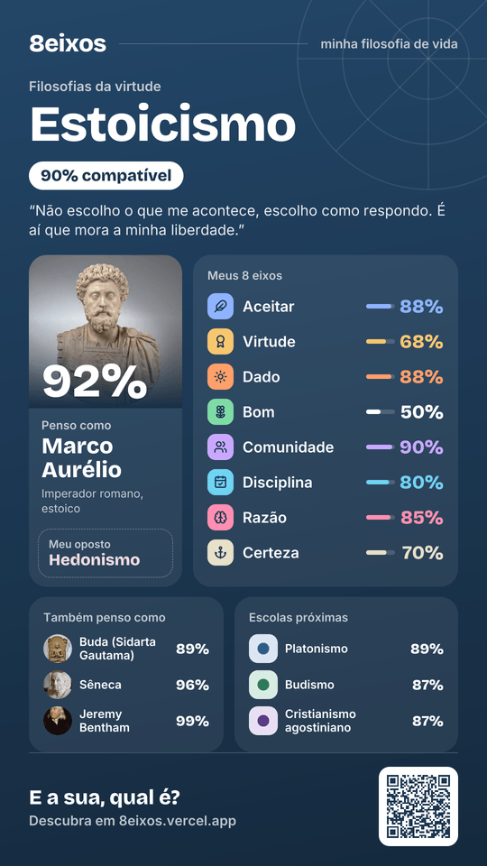

<div align="center">

# 8eixos

Um quiz de filosofia de vida que mede você em oito eixos independentes e mostra quais das 30 escolas filosóficas e dos 77 pensadores mais se parecem com o seu jeito de viver.

**[8eixos.vercel.app](https://8eixos.vercel.app)** · em português · sem cadastro · grátis

    

</div>

## Visão geral

Quase todo teste de "qual filosofia combina com você" faz meia dúzia de perguntas e devolve um rótulo. O 8eixos mede cada dimensão separadamente. Assim, quem é disciplinado e ao mesmo tempo desconfia de toda certeza, ou quem acredita num sentido dado e quer transformar o mundo, vê essa combinação no resultado, sem uma média que a esconda.

O projeto nasceu junto do canal Reflexos da Vida, para levar filosofia de vida a quem nunca abriu um livro de filosofia.

## Sobre o projeto

### O que é

Um quiz anônimo. Você responde a frases numa escala de concordância (ou escolhe entre duas frases) e recebe:
- uma posição em cada um dos oito eixos;
- a escola filosófica mais próxima e o pensador que pensa mais parecido com você;
- o que é raro no seu perfil;
- como a sua escola lida com o sofrimento, a morte, a felicidade e as relações;
- livros para começar.

### Para quem é

- Gente curiosa sobre filosofia que quer se entender melhor.
- Estudantes comparando escolas.
- Quem quer descobrir com qual pensador concorda e em que discorda dos amigos.

### O que o diferencia

- **Eixos medidos de forma independente.** O resultado guarda tensões e combinações incomuns, em vez de forçar um rótulo único.
- **Catálogo variado.** Tem tradições gregas, orientais, cristãs, judaica, islâmica, espírita, africana e modernas, com 7 mulheres entre os pensadores e um brasileiro, Machado de Assis.
- **Perfis calculados, não colocados à mão.** Cada escola e cada pensador respondeu às mesmas 120 perguntas que você responde, e a posição dele vem dessas respostas.
- **Card pronto para o story**, comparação eixo a eixo com amigos, pensadores ou escolas, e um link que refaz o resultado sem guardar nada em servidor.

### Os 8 eixos

| Eixo | Polo A | Polo B | Pergunta de fundo |
|------|--------|--------|-------------------|
| Controle | Aceitar | Transformar | Diante do que dá errado, você aceita ou age para mudar? |
| Bem viver | Virtude | Prazer | Uma vida boa é uma vida correta ou uma vida bem aproveitada? |
| Sentido | Dado | Criado por mim | O sentido da vida já existe ou cada um constrói o seu? |
| Mundo | Bom | Hostil | Você olha o mundo e as pessoas com confiança ou com desconfiança? |
| Eu | Indivíduo | Comunidade | Sua prioridade é o próprio caminho ou os laços com os outros? |
| Rotina | Disciplina | Espontaneidade | Hábito e regra, ou improviso e intensidade? |
| Guia | Razão | Emoção | Nas decisões, você confia na lógica ou no que sente? |
| Verdade | Certeza | Dúvida | Dá para chegar a verdades firmes ou é melhor manter as perguntas abertas? |

Os eixos partem da análise do PhilPapers Survey, que encontrou cerca de sete dimensões nas opiniões dos filósofos. Antes de cada lançamento, um teste confere que nenhum par de eixos mede a mesma coisa no catálogo.

### Famílias de escolas

As 30 escolas se agrupam em oito famílias, que dão a cor do resultado e ajudam a ler o mapa:
- Filosofias da virtude
- Caminhos orientais
- Filosofias do sentido
- Filosofias do prazer
- Filosofias da dúvida
- Tradições cristãs
- Razão e sociedade
- Caminhos de fé

A família é só um rótulo para leitura e não entra no cálculo.

### Como o resultado é calculado

1. Cada resposta puxa um eixo para um dos polos. Concordar totalmente conta inteiro, "neutro" deixa o eixo no meio, e discordar puxa para o outro lado.
2. A média das respostas em cada eixo vira um número de 0 a 100 entre os dois polos.
3. Os oito números formam o seu perfil, que é comparado com cada escola e cada pensador. Os mais próximos aparecem com uma porcentagem de compatibilidade.

### Perguntas e formatos

| Formato | Perguntas | Por eixo | Tempo |
|---------|----------:|---------:|------:|
| Rápida | 32 | 4 | ~5 min |
| Equilibrada | 64 | 8 | ~10 min |
| Profunda | 120 | 15 | ~20 min |

- **O banco:** tem 120 frases, 15 por eixo, metade escrita a favor de cada polo, para que concordar com tudo não distorça o resultado.
- **Escolha forçada:** 18 delas, ao menos uma por eixo, pedem para escolher entre duas frases. Isso evita que respostas "bonitas" dos dois lados se anulem.
- **Rápida e Equilibrada:** sorteiam um subconjunto equilibrado. Quem refaz o quiz recebe primeiro as perguntas que ainda não viu.
- **Seu retrato final:** no fim, cinco perguntas de múltipla escolha. Cada alternativa traz uma posição em dois ou três eixos ao mesmo tempo.

| Resposta | Valor |
|----------|------:|
| Concordo totalmente | 1,00 |
| Concordo | 0,75 |
| Neutro | 0,50 |
| Discordo | 0,25 |
| Discordo totalmente | 0,00 |

### Nota sobre o método

O 8eixos é uma ferramenta para pensar, não um instrumento científico. Uma compatibilidade alta quer dizer que as suas respostas estão perto de um perfil, não que você pertence a uma escola ou a uma religião. Os perfis são modelos simplificados, e as perguntas carregam inevitavelmente o olhar de quem as escreveu. Correções são bem-vindas (veja [Como contribuir](#como-contribuir)).

## Funcionalidades

- Três formatos de quiz, com avanço automático, botão de voltar, troca de pergunta e progresso salvo no navegador.
- "O que isso mede?" em cada pergunta, explicando para onde cada resposta puxa e quem pensa assim.
- Resultado por eixo, com o que é incomum no seu perfil e as tensões entre posições que raramente andam juntas.
- Escola principal, escolas próximas, pensador principal, pensadores parecidos em cada dimensão ("na ação", "no sentido", "no pensar") e a escola oposta.
- Como a sua escola lida com o sofrimento, a morte, a felicidade e as relações.
- Livros recomendados, com capa real.
- Card de story (1080×1920), imagem de compartilhamento e link do resultado.
- Comparação eixo a eixo com um amigo, um pensador ou uma escola, com busca digitada.
- Páginas estáticas e indexáveis para cada escola, cada pensador e cada par de escolas (435 comparações).
- Apoio por Pix (QR code e copia e cola gerados no navegador).

## Demonstração

<div align="center">

</div>

O card resume um resultado: a escola e a família, a compatibilidade, o pensador mais parecido, a posição em cada um dos oito eixos, os pensadores e as escolas mais próximos e um QR code de volta para o quiz.

## Arquitetura

### Stack

| Camada | Tecnologia |
|--------|------------|
| App | Next.js 16 (App Router, Cache Components), React 19, TypeScript 5 |
| Estilo | Tailwind CSS 4, fontes Unbounded e Manrope |
| Dados | JSON versionado, validado com Zod 4 na leitura |
| Imagens | `next/og` (Satori) para o card e as imagens de compartilhamento |
| Testes | Vitest 5 e Testing Library |
| CI | GitHub Actions: testes, checagem dos eixos e build |
| Deploy | Vercel (o push na `main` publica) |

Não há banco de dados nem conta de usuário. O resultado vive inteiro na URL (`/resultado?c=…&b=…`), e o progresso do quiz fica no `localStorage` do navegador.

### Dados do projeto

Tudo fica em `data/`:

| Arquivo | Conteúdo |
|---------|----------|
| `axes.json` | Os 8 eixos, seus polos e descrições |
| `questions.json` | As 120 perguntas, com eixo, polaridade e tipo (concordância ou escolha forçada) |
| `retrato.json` | As 5 perguntas de múltipla escolha do retrato final |
| `families.json` | As famílias de escolas e suas cores |
| `schools.json` | Escolas: frase, resumo, como lidam com a vida e pensadores |
| `thinkers.json` | Pensadores: descrição, datas, biografia e retrato (com fonte e licença) |
| `books.json` | Livros recomendados por pensador |
| `answers/school/*.json`, `answers/thinker/*.json` | As 120 respostas de cada perfil |
| `generated/vectors.json` | Os vetores calculados a partir das respostas (gerado, não editar à mão) |

### Estrutura do repositório

```txt
8eixos/
├── data/                  catálogo, perguntas e respostas dos perfis
├── public/
│   ├── retratos/          fotos dos pensadores (Wikimedia Commons)
│   ├── capas/             capas dos livros (Open Library)
│   └── exemplos/          cards de exemplo da home
├── scripts/               vetores, checagem dos eixos, validação de perfil
├── src/
│   ├── app/               páginas (quiz, resultado, escolas, pensadores, comparar) e rotas de imagem
│   ├── components/        home, quiz, resultado
│   └── lib/               cálculo, comparação, seleção de perguntas, Pix, validação
├── tests/                 Vitest
└── .claude/commands/      comando do Claude Code para criar perfis
```

### Como a comparação funciona

O seu resultado é um vetor de oito valores de 0 a 100. `matchScore` (em `src/lib/matching.ts`) compara esse vetor com cada perfil em quatro partes:

| Parte | Peso | O que mede |
|-------|-----:|------------|
| Por eixo | 0,45 | Distância em cada eixo, com penalidade extra quando você e o perfil estão em lados opostos do centro |
| Direção | 0,30 | Se os dois vetores apontam para o mesmo lado, com menos peso perto do centro, onde a direção é quase ruído |
| Intensidade | 0,15 | Se a sua intensidade geral é parecida com a do perfil, para que alguém moderado não case com um perfil extremo |
| Pior eixo | 0,10 | Penalidade para um único eixo muito distante |

A calibração tem teste próprio: respostas com ruído, geradas a partir de cada escola, precisam encontrar essa escola entre as três primeiras em pelo menos 90% das vezes.

### Rodar localmente

Precisa de Node 22.12 ou mais novo.

```bash
npm install
npm run dev        # http://localhost:3000
```

| Variável | Uso |
|----------|-----|
| `NEXT_PUBLIC_SITE_URL` | URL pública (sitemap, card, metadados) |
| `NEXT_PUBLIC_GA_ID` | ID do Google Analytics (opcional) |
| `NEXT_PUBLIC_AMAZON_TAG` | Tag de afiliado da Amazon nos links de livros (opcional; vazio, os links saem sem tag) |
| `NEXT_PUBLIC_PAYWALL_ENABLED` | Reservado para o relatório pago, ainda não lançado |

Veja `.env.example`. Nenhuma credencial vai para o repositório.

### Testes

```bash
npm test             # Vitest
npm run check:axes   # nenhum par de eixos redundante no catálogo
npm run build        # checagem de tipos e build de produção
```

Os testes cobrem:
- o banco de perguntas e os três formatos;
- a seleção que evita repetir perguntas;
- o retrato final e o cálculo;
- cada perfil do catálogo e a calibração;
- as páginas, o card de story e o código Pix;
- os cabeçalhos de segurança.

## Como contribuir

Avisos de erro e correções de perfis são bem-vindos como [issue](https://github.com/DevTheusP/8eixos/issues) ou pull request. Mantenha cada pull request com uma mudança só, rode os testes e diga como testou.

### Adicionar uma escola ou um pensador

Os perfis não são posicionados à mão. Cada perfil novo responde às 120 perguntas, uma por uma, no papel da escola ou do pensador, e o vetor sai dessas respostas pela mesma fórmula usada para você. O projeto traz um comando do [Claude Code](https://claude.com/claude-code) que faz o processo de ponta a ponta:

```
/novo-perfil school <nome da escola>
/novo-perfil thinker <nome do pensador>
```

Antes de entrar, um perfil novo precisa:

- Passar em `npm run validate -- <school|thinker> <id>`, que barra respostas faltando, neutras demais (mais de 40%) e perfis quase iguais a outro.
- Manter os eixos independentes (`npm run check:axes`) e a calibração das escolas (`npm test`).
- Ter textos em português simples, que descrevam cada tradição como seus seguidores a reconheceriam.
- Usar retratos do Wikimedia Commons com licença livre, com fonte e licença registradas (aparecem em `/creditos`).

Depois de mexer em respostas, rode `npm run vectors` para recalcular `data/generated/vectors.json`.

### Licença

O 8eixos tem código visível, mas não é código aberto. O código, as perguntas, os perfis e os vetores têm todos os direitos reservados. Você pode ler o código e enviar contribuições, mas copiar, redistribuir ou usar qualquer parte sem autorização por escrito não é permitido. Veja [LICENSE](LICENSE).

## Autor

Feito por [DevTheusP](https://github.com/DevTheusP). A ideia do formato veio do [12 Axes](https://12axes.vercel.app), um quiz político em doze eixos. Nenhum código, pergunta ou texto foi copiado de lá.
